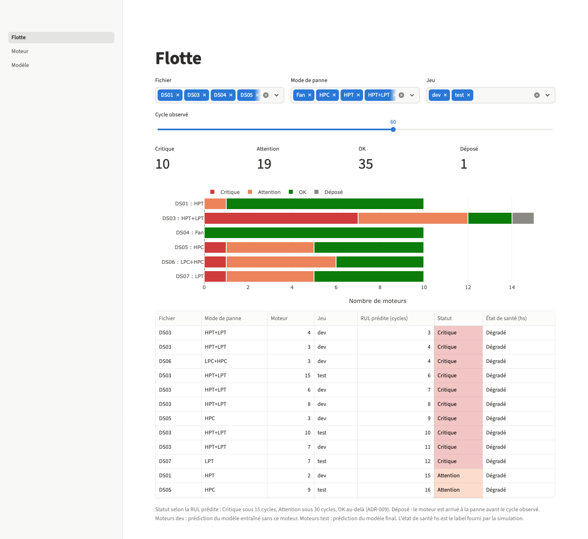
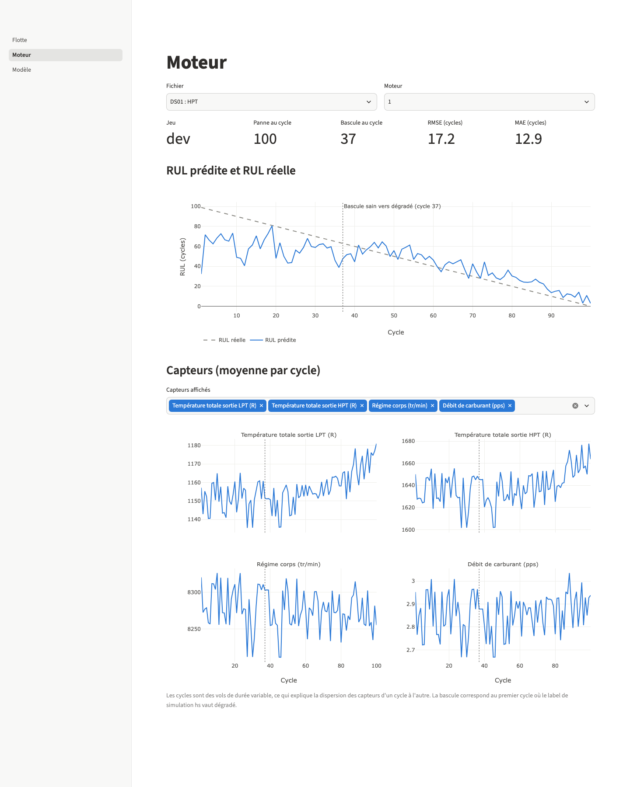
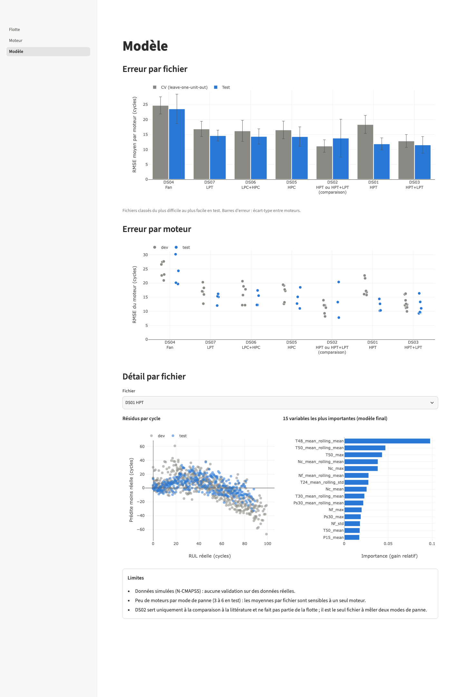
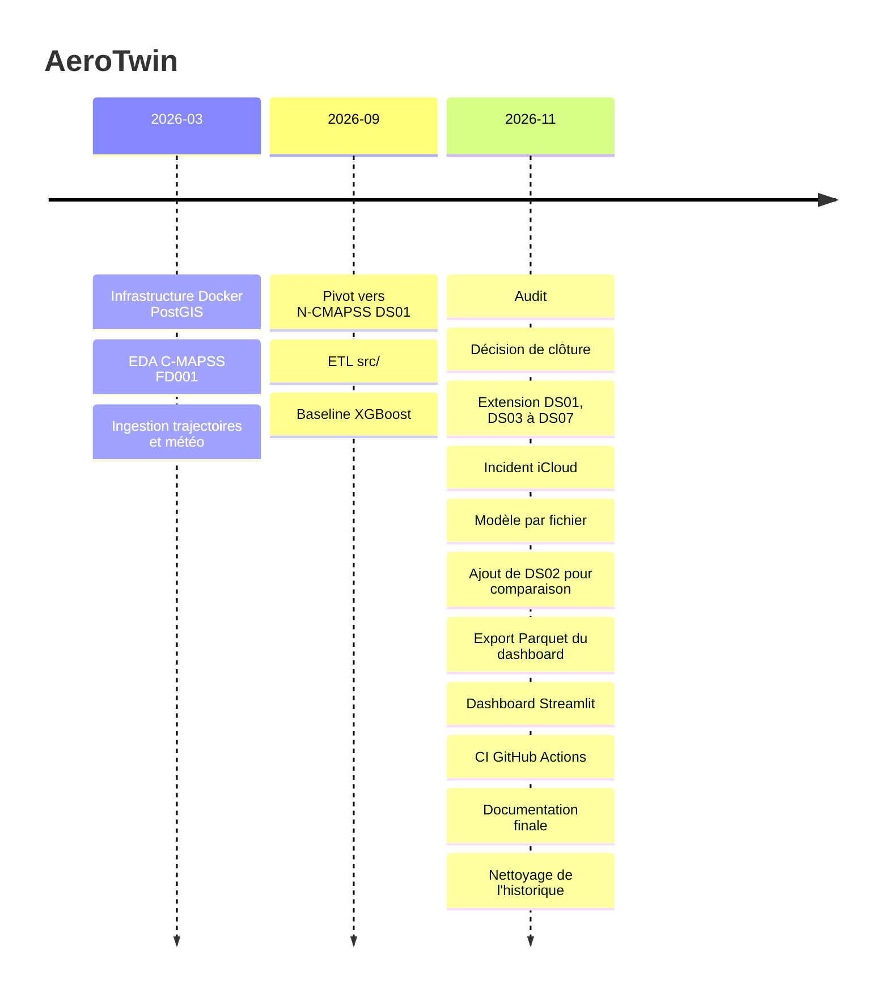

# AeroTwin

AeroTwin predicts the remaining useful life (RUL) of turbofan engines on NASA's simulated N-CMAPSS dataset, with one XGBoost model per file across six failure modes and 65 engines.
Results are reported per engine with the between-engine standard deviation; DS02 is included only for comparison with published work.
A three-page Streamlit dashboard reads precomputed Parquet files. The project was closed in November 2026.

**Démo : https://aerotwin-sirngoma.streamlit.app** (l'application peut mettre une minute à se réveiller si elle n'a pas été utilisée récemment).

**Statut : Projet terminé (novembre 2026)**

## Ce que fait le projet

AeroTwin estime la durée de vie résiduelle (RUL) de moteurs d'avion à partir du jeu de données simulé N-CMAPSS de la NASA. Les mesures à 1 Hz sont agrégées par cycle de vol, puis un modèle XGBoost est entraîné par fichier, un fichier correspondant à un mode de panne. Les prédictions sont exportées en Parquet et consultées dans un dashboard Streamlit, qui ne lit jamais le HDF5.

| Fichier | Mode de panne | Moteurs dev / test | Usage |
|---|---|---|---|
| DS01 | HPT | 6 / 4 | Flotte |
| DS03 | HPT+LPT | 9 / 6 | Flotte |
| DS04 | Fan | 6 / 4 | Flotte |
| DS05 | HPC | 6 / 4 | Flotte |
| DS06 | LPC+HPC | 6 / 4 | Flotte |
| DS07 | LPT | 6 / 4 | Flotte |
| DS02 | HPT ou HPT+LPT | 6 / 3 | Comparaison à la littérature |

## Dashboard

La page Flotte affiche l'état des 65 moteurs à un cycle choisi. Le statut dépend d'une RUL prudente, RUL prédite moins le RMSE test du fichier : Critique sous 15 cycles, Attention sous 30 ([ADR-009](docs/decisions/009-streamlit-export-parquet.md)).



La page Moteur montre la RUL prédite contre la RUL réelle, les capteurs et la bascule de sain à dégradé.



La page Modèle compare les erreurs entre fichiers et par moteur, puis détaille résidus et importance des variables.



## Résultats

Moyenne ± écart-type entre moteurs, en cycles. La CV est en leave-one-unit-out sur les moteurs dev, le test porte sur les moteurs test officiels. Le détail par moteur est dans [`docs/resultats.md`](docs/resultats.md#par-moteur), généré par `python -m src.train --all`.

| Fichier | Mode de panne | Moteurs CV / test | RMSE CV | MAE CV | RMSE test | MAE test |
|---|---|---|---|---|---|---|
| DS01 | HPT | 6 / 4 | 18.38 ± 3.02 | 14.38 ± 3.04 | 11.89 ± 2.01 | 9.50 ± 1.81 |
| DS02 | HPT ou HPT+LPT | 6 / 3 | 11.15 ± 2.10 | 8.19 ± 1.22 | 13.80 ± 6.33 | 11.26 ± 6.18 |
| DS03 | HPT+LPT | 9 / 6 | 12.87 ± 2.14 | 10.06 ± 1.91 | 11.55 ± 2.79 | 8.67 ± 1.74 |
| DS04 | Fan | 6 / 4 | 24.75 ± 2.87 | 20.19 ± 2.58 | 23.60 ± 4.90 | 19.55 ± 4.49 |
| DS05 | HPC | 6 / 4 | 16.55 ± 2.95 | 13.34 ± 2.55 | 14.34 ± 3.24 | 11.43 ± 2.19 |
| DS06 | LPC+HPC | 6 / 4 | 16.24 ± 3.52 | 12.85 ± 2.69 | 14.36 ± 2.55 | 11.74 ± 2.10 |
| DS07 | LPT | 6 / 4 | 16.89 ± 2.54 | 13.31 ± 1.79 | 14.66 ± 1.81 | 11.35 ± 1.02 |

Avec 3 à 6 moteurs de test par fichier, les écarts entre CV et test relèvent surtout de la variance entre moteurs. DS04 (Fan) est le mode de panne le plus difficile à pronostiquer.

## Situation par rapport à la littérature

Les approches deep learning publiées sur ce découpage de DS02 obtiennent des erreurs nettement plus faibles que notre baseline : RMSE test de 7.89 ± 0.12 (FNN) et 4.95 ± 0.15 (CNN) sur données seules, 4.22 ± 0.10 (FNN) et 4.14 ± 0.09 (CNN) en approche hybride. Leur RMSE est calculé par pas de temps (échantillons à 0,1 Hz), avec un écart-type sur 5 exécutions ; le nôtre est calculé par cycle, avec un écart-type entre moteurs. La comparaison n'est donc pas directe. Notre baseline XGBoost sur agrégats par cycle n'a pas cherché à les égaler : c'est un choix de périmètre ([ADR-006](docs/decisions/006-cloture-projet.md)).

Source des chiffres : Arias Chao, M. ; Kulkarni, C. ; Goebel, K. ; Fink, O. Fusing Physics-based and Deep Learning Models for Prognostics. Préprint arXiv:2003.00732v2, 27 octobre 2020, table 5. https://arxiv.org/abs/2003.00732

Version publiée, non consultée : Arias Chao, M. ; Kulkarni, C. ; Goebel, K. ; Fink, O. Fusing physics-based and deep learning models for prognostics. Reliability Engineering & System Safety, vol. 217, art. 107961, janvier 2022. https://doi.org/10.1016/j.ress.2021.107961

## Limites

- Les données sont simulées : aucune validation sur des données réelles.
- Il y a peu de moteurs par mode de panne, et la moyenne d'un fichier dépend fortement d'un seul moteur (DS02 en test : 7.76 à 20.39 selon le moteur).
- Les hyperparamètres sont identiques pour tous les fichiers, sans recherche : le modèle reste une baseline.
- DS02 mêle deux modes de panne dans un même fichier.
- La marge de la RUL prudente vient du RMSE test, estimé sur ces mêmes moteurs : la règle de statut n'a pas été évaluée séparément. Les seuils ne sont pas calibrés sur un coût opérationnel.
- Les trajectoires simulées et la météo restent dans le dépôt mais n'alimentent ni le modèle ni le dashboard.

## Ce que j'ai appris

> Brouillon, à réécrire par l'auteur.

- Un chiffre n'a de valeur que s'il est comparable : la référence « RMSE 36.89 » venait d'un projet FD001 en split aléatoire et a été retirée.
- Avec quelques moteurs de test, un bon score peut être un effet de variance : sur DS01, le RMSE test (11.89) est meilleur que la CV (18.38). Publier les erreurs par moteur et l'écart-type est plus honnête qu'un chiffre unique.
- Un réglage doit prouver son effet : le plafond RUL à 125 ne faisait rien, la RUL maximale étant de 99.
- La fuite de données se traite à la conception : exclusion des groupes `X_v` et `T`, validation croisée par moteur (ADR-004, ADR-005).
- Finir demande de réduire : neuf phases prévues pour un projet solo, ramenées à un modèle honnête, un dashboard et une documentation (ADR-006).
- Une vérification doit être réellement vérifiée : un commit a été poussé avec deux tests en échec parce qu'un pipe vers `tail` masquait le code de retour de pytest.

## Pistes non retenues

Ces idées ont été écartées lors de la clôture ([ADR-006](docs/decisions/006-cloture-projet.md)) et ne sont pas codées.

- LSTM / Transformer pour le pronostic, et détection d'anomalies.
- Orchestration Prefect et transformations SQL dbt.
- Streaming ADS-B avec Kafka, Spark et lakehouse Iceberg.
- API FastAPI et déploiement sur GCP Cloud Run.
- Couche d'IA générative : RAG, agents.
- Carte des trajectoires dans le dashboard.
- Fichiers DS08a, DS08c et DS08d, qui dégradent plusieurs composants à la fois ([ADR-007](docs/decisions/007-jeux-de-donnees.md), [ADR-010](docs/decisions/010-ajout-ds02.md)).

## Chronologie

Le détail est dans [`docs/CHRONOLOGIE.md`](docs/CHRONOLOGIE.md).



## Stack technique

| Outil | Version | Rôle | ADR |
|---|---|---|---|
| Python | 3.13 | Langage du projet, de la CI et du déploiement | [012](docs/decisions/012-environnement-ci.md) |
| XGBoost | 3.4.1 | Modèle de RUL par fichier | [011](docs/decisions/011-modele-xgboost.md) |
| scikit-learn | 1.9.1 | Validation croisée leave-one-unit-out | [005](docs/decisions/005-cv-leave-one-unit-out.md) |
| pandas | 3.1.1 | Agrégation par cycle et tables | [003](docs/decisions/003-agregation-cycle.md) |
| NumPy | 2.5.4 | Calcul numérique et métriques | [003](docs/decisions/003-agregation-cycle.md) |
| h5py | 3.16.0 | Lecture du HDF5 N-CMAPSS | [002](docs/decisions/002-abandon-fd001-ncmapss.md) |
| MLflow | 3.18.0 | Suivi local des expériences | [012](docs/decisions/012-environnement-ci.md) |
| Streamlit | 1.67.0 | Dashboard à trois pages | [009](docs/decisions/009-streamlit-export-parquet.md) |
| Plotly | 7.1.0 | Graphiques du dashboard | [009](docs/decisions/009-streamlit-export-parquet.md) |
| PyArrow | 26.0.1 | Export et lecture des Parquet | [009](docs/decisions/009-streamlit-export-parquet.md) |
| pytest | 9.2.0 | Tests sur fixtures | [012](docs/decisions/012-environnement-ci.md) |
| GitHub Actions | sans objet | CI Pytest à chaque push | [012](docs/decisions/012-environnement-ci.md) |
| JupyterLab | 4.6.6 | Exploration de N-CMAPSS | [002](docs/decisions/002-abandon-fd001-ncmapss.md) |
| Docker, PostGIS | postgis/postgis:15-3.3 | Stockage de la chaîne ETL optionnelle | [001](docs/decisions/001-docker-postgis.md) |
| SQLAlchemy, GeoAlchemy2, psycopg2 | 2.1.8, 0.21.0, 2.9.13 | Chargement dans PostGIS | [001](docs/decisions/001-docker-postgis.md) |
| python-dotenv | 1.2.4 | Identifiants hors du code, dans `.env` | [001](docs/decisions/001-docker-postgis.md) |
| GeoPandas, Shapely | 1.2.0, 2.2.0 | Trajectoires simulées, hors modèle | [013](docs/decisions/013-trajectoires-meteo.md) |
| requests, metar | 2.34.2, 2.0.2 | Météo Open-Meteo et METAR, hors modèle | [013](docs/decisions/013-trajectoires-meteo.md) |

## Décisions d'architecture

| ADR | Décision | Statut |
|---|---|---|
| [001](docs/decisions/001-docker-postgis.md) | Infrastructure Docker + PostGIS | Acceptée |
| [002](docs/decisions/002-abandon-fd001-ncmapss.md) | Abandon de C-MAPSS FD001 au profit de N-CMAPSS | Acceptée |
| [003](docs/decisions/003-agregation-cycle.md) | Agrégation 1 Hz vers cycle le plus tôt possible | Acceptée |
| [004](docs/decisions/004-exclusion-xv-t.md) | Exclusion des groupes `X_v` et `T` | Acceptée |
| [005](docs/decisions/005-cv-leave-one-unit-out.md) | Validation croisée leave-one-unit-out | Acceptée |
| [006](docs/decisions/006-cloture-projet.md) | Abandon des phases 5 à 9 et clôture du projet | Acceptée |
| [007](docs/decisions/007-jeux-de-donnees.md) | Jeux de données retenus | Remplacée par ADR-010 |
| [008](docs/decisions/008-plafond-rul.md) | Suppression du plafond RUL | Acceptée |
| [009](docs/decisions/009-streamlit-export-parquet.md) | Streamlit + export Parquet | Acceptée |
| [010](docs/decisions/010-ajout-ds02.md) | Ajout de DS02 pour comparaison à la littérature | Acceptée |
| [011](docs/decisions/011-modele-xgboost.md) | Modèle XGBoost, hyperparamètres fixes, un modèle par fichier | Acceptée |
| [012](docs/decisions/012-environnement-ci.md) | MLflow local, Python 3.13, dépendances figées, CI sur fixtures | Acceptée |
| [013](docs/decisions/013-trajectoires-meteo.md) | Trajectoires simulées et météo écartées du modèle et du dashboard | Acceptée |

## Lancer en local

Depuis la racine du dépôt, sans télécharger les données :

```bash
python3.13 -m venv venv && source venv/bin/activate
pip install -r dashboard/requirements.txt
streamlit run dashboard/app.py
```

## Reproduire les résultats

Prérequis : Python 3.13 et environ 51 Go libres pour l'archive N-CMAPSS (15,8 Go), les sept `.h5` extraits (20,6 Go) et la marge de 15 Go contrôlée par le script.

```bash
python3.13 -m venv venv
source venv/bin/activate
pip install -r requirements.txt

python -m scripts.download_ncmapss     # archive officielle NASA, écrit docs/data.md
python -m src.train --all              # entraîne les modèles, écrit docs/resultats.md
python -m src.export_dashboard         # écrit data/dashboard/*.parquet
streamlit run dashboard/app.py         # depuis la racine du dépôt
pytest tests/ -v                       # sur fixtures, sans .h5
```

Avec le Python de python.org sur macOS, le téléchargement demande de préfixer la commande par `SSL_CERT_FILE="$(python -m certifi)"`. Le script laisse par défaut 15 Go libres après extraction.

Le dashboard et les tests fonctionnent sans télécharger les données, à partir des Parquet versionnés. La chaîne ETL vers PostGIS (`docker compose up -d`, `.env` à créer depuis `.env.example`, puis `python -m src.pipeline --ds DS01 --split dev`) reste disponible mais n'est pas nécessaire au modèle.


## Documents

- [Résultats](docs/resultats.md), [données](docs/data.md), [chronologie](docs/CHRONOLOGIE.md)
- [Changelog](CHANGELOG.md), [feuille de route initiale](ROADMAP.md)
- [Documentation de l'ETL](docs/phase3_etl.md), [exploration N-CMAPSS](notebooks/phase2/05_exploration_ncmapss.ipynb)
