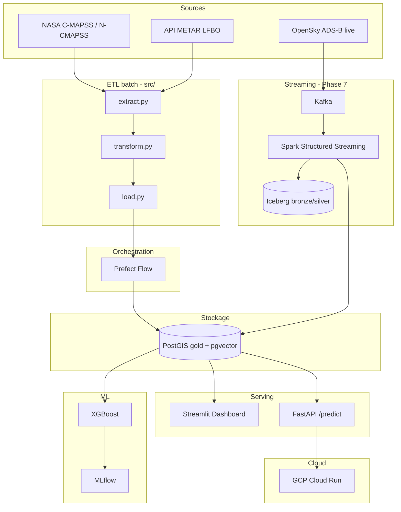

# AeroTwin

**Jumeau numérique d'une flotte aéronautique — maintenance prédictive sur données capteurs, météo et trajectoires spatiales.**

> Projet portfolio — Ingénieur ESIR (Systèmes d'Information), promotion 2026
> Objectif : poste de **Data Engineer** dans l'écosystème aéronautique toulousain.

AeroTwin construit le jumeau numérique d'une flotte d'avions opérant depuis **Toulouse-Blagnac (LFBO)**. Le système fusionne des données de capteurs thermodynamiques (NASA N-CMAPSS), des données météo réelles (API METAR / Open-Meteo) et des trajectoires GPS, avec pour objectif final de prédire la **Durée de Vie Résiduelle (RUL)** des moteurs.

---

## État du projet en un coup d'œil

Le projet est en construction, développé par phases. Cette section distingue volontairement **ce qui fonctionne réellement aujourd'hui** de ce qui est planifié. La feuille de route détaillée se trouve dans [`ROADMAP.md`](ROADMAP.md).

| | Phase | Statut |
|---|---|---|
| ✅ | 0-1 — Base du projet + legacy FD001 (Docker, secrets, EDA, trajectoires, météo) | **Fait** |
| ✅ | 2 — Exploration & compréhension N-CMAPSS | **Fait** |
| ✅ | 3 — ETL production (`src/` : extract, transform, load, pipeline) — flux complet validé | **Fait** |
| ✅ | 4.1 — Baseline XGBoost (RMSE 11.79 sur le split test officiel) | **Fait** |
| ⏳ | 4.2-4.4 — MLflow avancé, LSTM, Anomaly Detection | Planifié |
| ⏳ | 5 — CI/CD (GitHub Actions) | Planifié |
| ⏳ | 6 — Dashboard Streamlit | Planifié |
| ⏳ | 7 — Streaming temps réel (ADS-B → Kafka → Spark → Iceberg) | Planifié |
| ⏳ | 8 — API FastAPI + déploiement cloud (GCP Cloud Run) | Planifié |
| ⏳ | 9 — Couche IA générative & agentique (RAG, agents) | Planifié |

---

## ✅ Ce qui tourne aujourd'hui

Voici les composants concrets, exécutables, déjà livrés et validés.

**Base du projet (Phase 0)**
Environnement reproductible via `docker-compose` : PostGIS 15 + pgAdmin, avec volumes persistants. Les identifiants sont externalisés dans un fichier `.env` (jamais committé — voir [installation](#installation--lancement-en-local)).

**Exploration N-CMAPSS (Phase 2)**
- Notebook [`notebooks/phase2/05_exploration_ncmapss.ipynb`](notebooks/phase2/05_exploration_ncmapss.ipynb) : lecture des 6 blocs HDF5 (`A`, `W`, `X_s`, `X_v`, `T`, `Y`), justification des blocs retenus pour le ML (`A`, `W`, `X_s`, `Y`) vs exclus (`X_v`, `T` — data leakage), structure `unit`/`cycle`, distribution des conditions de vol, dérive d'un capteur de température avant panne, recherche de colonnes constantes au niveau cycle.
- Les notebooks `01` à `04` (exploration FD001, génération de trajectoires, scraper météo, ingestion PostGIS — dataset legacy) ont été supprimés : leur logique est entièrement reprise et testée dans `src/` (`extract.py`, `transform.py`, `load.py`), y compris le fetch METAR live (`fetch_metar_live`) qui n'existait jusque-là que dans le notebook.

**ETL production (Phase 3 — `src/`)**
- `src/config.py` : configuration centralisée (chemins, `.env`, paramètres de feature engineering)
- `src/extract.py` : lecture du HDF5 N-CMAPSS (`read_ncmapss`) + contexte météo historique Open-Meteo (`fetch_weather_history`)
- `src/transform.py` : agrégation `(unit, cycle)`, suppression des colonnes constantes, rolling features, génération de trajectoires GeoPandas
- `src/load.py` : chargement PostGIS (tabulaire et géospatial) via SQLAlchemy / GeoAlchemy2
- `src/pipeline.py` : orchestration extract → transform → load, exécutable en CLI (`python -m src.pipeline`)
- **11/11 tests Pytest** passent (`tests/test_phase3_etl.py`, `tests/test_transform.py`, `tests/test_pipeline_p1.py`), y compris le test anti data-leakage sur les rolling features.
- **Flux complet exécuté sur le vrai dataset** `N-CMAPSS_DS01-005.h5` : 4 906 636 lignes 1 Hz → 553 cycles agrégés (6 moteurs) → rolling features → chargement PostGIS, sans erreur.
- Documentation : [`docs/phase3_etl.md`](docs/phase3_etl.md).
- Reste en amélioration future, non bloquant pour le ML : orchestration **Prefect** (`src/pipelines/flow_ds01.py` est un squelette non implémenté) et transformations SQL versionnées **dbt** — le pipeline actuel s'appuie sur une orchestration Python simple (`pipeline.py`), suffisante pour un flux fiable et reproductible.

**Baseline ML (Phase 4.1 — `src/features.py`, `src/train.py`)**
- Features : conditions de vol `alt`/`Mach`/`TRA`/`T2` (mean/std/min/max par cycle) + `Fc` one-hot + rolling mean/std sur les 14 capteurs physiques (`X_s`)
- **XGBoost**, cross-validation leave-one-unit-out sur le split dev (6 moteurs, zéro fuite inter-moteur), évaluation finale sur le split test officiel (moteurs 7-10, jamais vu à l'entraînement)
- **RMSE test = 11.79** (MAE 9.24, R² 0.77), RUL plafonnée à 125
- Tracking **MLflow** (params, métriques CV + test, modèle) — **16/16 tests Pytest** au total (`tests/test_features.py`, `tests/test_train.py`)

---

## ⏳ Ce qui est planifié

Le détail, les choix techniques et le découpage en tâches figurent dans [`ROADMAP.md`](ROADMAP.md). En résumé :

- **Phase 4.2-4.4 — Machine Learning (suite)** : comparaison capped/non-capped RUL et sauvegarde du meilleur modèle en artefact MLflow (4.2), architecture séquentielle LSTM/Transformer (4.3), Anomaly Detection en module parallèle (4.4).
- **Phase 5 — CI/CD** : exécution automatique de Pytest via **GitHub Actions** à chaque push.
- **Phase 6 — Dashboard** : interface **Streamlit** (vue flotte, drill-down moteur, vue météo, carte des trajectoires).
- **Phase 7 — Streaming temps réel** : positions ADS-B live (OpenSky) autour de LFBO → **Kafka** → **Spark Structured Streaming** → tables **Apache Iceberg** (requêtées via DuckDB), agrégats servis par PostGIS. Architecture médaillon bronze/silver/gold, batch et streaming coexistant.
- **Phase 8 — Déploiement** : API **FastAPI** `/predict` + modèle, déploiement sur **GCP Cloud Run**.
- **Phase 9 — IA générative & agents** : pipeline d'embeddings **pgvector**, **Fleet Copilot** (RAG hybride vectoriel + text-to-SQL), agent de diagnostic **LangGraph** déclenché par Prefect.

---

## Couche IA générative & agentique (Phase 9)

> L'infrastructure de données AI-ready est devenue une compétence centrale du data engineering. Cette phase étend AeroTwin au-delà du ML classique : les données de la flotte deviennent exploitables par des LLM et des agents.

- **Pipeline AI-ready** : vectorisation des états moteur et rapports d'anomalies dans **pgvector**, indexation orchestrée par Prefect.
- **Fleet Copilot (RAG)** : assistant conversationnel répondant en langage naturel sur l'état de la flotte — retrieval hybride (vectoriel pgvector + text-to-SQL sur PostGIS), avec évaluation de la fidélité des réponses.
- **Agent de diagnostic** : workflow LangGraph multi-étapes détection anomalie → contexte historique → corrélation stream ADS-B/météo → rapport structuré → alerte.
- **Recommandations opérationnelles** : croiser RUL prédit + météo + trajectoire pour suggérer des ajustements de vol réduisant l'usure moteur et la consommation de carburant.

Stack : LlamaIndex / LangGraph · API LLM · pgvector + PostGIS comme store hybride.

---

## Choix techniques & décisions d'architecture

Les décisions structurantes sont documentées pour expliquer le *pourquoi*, pas seulement le *quoi*.

**N-CMAPSS plutôt que C-MAPSS FD001 (Phase 1).** FD001 est un dataset synthétique sans timestamps ni coordonnées réelles. N-CMAPSS (NASA 2021, HDF5) contient de vrais profils de vol avec phases (montée, croisière, descente), conditions atmosphériques à l'altitude de vol, et une dégradation physiquement cohérente — confirmé par la dérive de capteur observée en Phase 2. FD001 reste dans le repo comme clause de repli documentée.

**Agrégation au niveau cycle, le plus tôt possible (Phase 3).** DS01 = millions de lignes à 1 Hz. Résumé par `(unit, cycle)`, on retombe sur quelques centaines de lignes : EDA, rolling features, XGBoost et PostGIS restent légers. Le 1 Hz brut ne sort jamais de `extract → aggregate`.

**Trajectoires simulées plutôt que données radar réelles.** Associer arbitrairement de vraies trajectoires ADS-B aux données d'usure introduirait un biais massif dans le futur modèle. La simulation garantit l'intégrité : on génère une trajectoire cohérente avec la classe de vol et l'altitude de chaque moteur. Une V2 pourrait exploiter N-CMAPSS + OpenSky via Dynamic Time Warping.

**API METAR plutôt que web scraping.** Le scraping HTML de la NOAA était fragile (changements de structure, serveurs FTP instables). L'API REST de l'Aviation Weather Center fournit du JSON structuré et fiable.

**Prefect plutôt qu'Airflow (Phase 3+).** Airflow est surdimensionné pour un projet solo. Prefect est Python-natif, sans infrastructure supplémentaire, et s'intègre en décorant les fonctions existantes (`@flow`, `@task`) déjà écrites et testées dans `src/`.

**dbt pour les transformations SQL (Phase 3+).** Permet de versionner les modèles SQL (staging → marts), de les tester et de documenter le lineage, avec une intégration native à PostGIS via `dbt-postgres`.

**Kafka + Spark Structured Streaming plutôt qu'un simple consumer Python (Phase 7).** Le volume ADS-B autour de LFBO ne l'exige pas techniquement, mais Kafka/Spark est le standard industriel du streaming : le choix démontre la compétence la plus demandée du marché tout en restant exécutable en local (Kafka KRaft en docker-compose, Spark en mode local).

**Apache Iceberg en couche lakehouse, PostGIS en serving (Phase 7).** Les données brutes et enrichies du stream vont dans des tables Iceberg (PyIceberg + DuckDB) — open table format, time travel, schema evolution. PostGIS ne garde que les agrégats servant le dashboard et l'API. Architecture médaillon : bronze → silver (Iceberg) → gold (PostGIS).

**Streamlit plutôt que Grafana (Phase 6).** Dashboard complet en Python pur, connecté directement à PostGIS, plus rapide à livrer pour un portfolio solo.

**GCP Cloud Run comme cible (Phase 8).** Crédits gratuits, compatibilité Docker native, scaling automatique. Azure est identifié comme objectif moyen terme vu son omniprésence dans l'écosystème Airbus/Toulouse.

---

## Stack technique

Légende : ✅ en place · ⏳ planifié.

| Couche | Outil | Rôle | Statut |
|---|---|---|---|
| Infrastructure | Docker + docker-compose | Environnement reproductible | ✅ |
| Stockage | PostGIS (PostgreSQL spatial) | Données tabulaires + géographiques | ✅ |
| ETL | Python (`src/`) | Extract / Transform / Load | ✅ |
| Tests | Pytest | Sécurisation du pipeline (16/16 verts) | ✅ |
| Source météo | Open-Meteo (historique) + API REST METAR/AWC (live) | Données environnementales LFBO | ✅ |
| Orchestration | Prefect | Automatisation des flows | ⏳ |
| Transformation SQL | dbt | Modélisation et tests sur PostGIS | ⏳ |
| ML | XGBoost + scikit-learn | Prédiction RUL (baseline 4.1 : RMSE 11.79) | ✅ |
| Experiment tracking | MLflow | Versioning des modèles | ✅ |
| CI/CD | GitHub Actions | Tests automatiques sur push | ⏳ |
| Dashboard | Streamlit + folium | Visualisation flotte + trajectoires | ⏳ |
| Streaming | Kafka + Spark Structured Streaming | Ingestion et traitement ADS-B live | ⏳ |
| Lakehouse | Apache Iceberg + DuckDB | Open table format, bronze/silver | ⏳ |
| API | FastAPI | Exposition du modèle en REST | ⏳ |
| Cloud | GCP Cloud Run | Déploiement public | ⏳ |
| GenAI | pgvector + LlamaIndex / LangGraph + API LLM | RAG, agent de diagnostic | ⏳ |

---

## Architecture cible



*Schéma de l'architecture visée. Aujourd'hui, les blocs Sources, ETL (`src/`) et Stockage (PostGIS) sont opérationnels et validés de bout en bout ; l'orchestration Prefect encadrant `load.py` reste à écrire.*

---

## Installation & lancement en local

**Prérequis** : Docker, Python 3.9+.

```bash
# 1. Cloner le dépôt puis créer le fichier d'environnement
cp .env.example .env
#    Éditer .env et remplacer les mots de passe par défaut

# 2. Démarrer PostGIS + pgAdmin
docker compose up -d
docker ps          # vérifier que les conteneurs sont "Up"

# 3. Créer l'environnement Python et installer les dépendances
python3 -m venv venv
source venv/bin/activate
pip install -r requirements.txt

# 4. Lancer le pipeline ETL de production sur le dataset N-CMAPSS
python -m src.pipeline --dataset data/raw/ncmapss/N-CMAPSS_DS01-005.h5 --split dev

# 5. Lancer les tests
pytest tests/ -v

# 6. (optionnel) Explorer via les notebooks
jupyter lab
```

pgAdmin est disponible sur `http://localhost:8080`.
Connexion PostGIS : `host=localhost port=5432 db=aerotwin_db` (identifiants définis dans votre `.env`).

> ⚠️ Les credentials ne sont **jamais** committés : `.env` est ignoré par Git. Seul `.env.example` (sans secret) est versionné.

---

## Structure du dépôt

```
aerotwin_project/
├── data/
│   ├── raw/              # NASA N-CMAPSS (HDF5), C-MAPSS FD001 — gitignorés
│   └── processed/        # Météo historique, trajectoires GeoJSON
├── notebooks/
│   └── phase2/           # Exploration N-CMAPSS (05_exploration_ncmapss.ipynb)
├── src/                  # ETL (extract, transform, load, pipeline) + baseline ML (features, train)
│   └── pipelines/        # Flow Prefect (squelette, à écrire)
├── tests/                # Tests Pytest (16/16 verts)
├── docs/                 # Documentation de la Phase 3 (phase3_etl.md)
├── docker-compose.yml    # PostGIS + pgAdmin
├── requirements.txt      # Dépendances Python
├── pyproject.toml        # Métadonnées du package + config Pytest
├── .env.example          # Modèle de configuration (à copier en .env)
├── README.md             # Ce fichier
└── ROADMAP.md             # Feuille de route détaillée & décisions techniques
```

---

## Pertinence pour le secteur aéronautique toulousain

| Acteur | Angle | Ce qu'AeroTwin démontre |
|---|---|---|
| **Airbus / sous-traitants** | Maintenance prédictive, données capteurs | Pipeline ETL de bout en bout, PostGIS spatial, RUL (cible Phase 4) |
| **Safran** | Digital twin, séries temporelles | Architecture jumeau numérique, dégradation physique N-CMAPSS |
| **Sopra Steria / Capgemini** | Conseil Data & IA industrie aéro | Stack de bout en bout, CI/CD, cloud (cible) |
| **OpenAirlines** | Optimisation des opérations + IA | Streaming ADS-B temps réel, couche GenAI / agents (Phases 7 & 9) |

---

## Documents

- [Feuille de route détaillée & décisions techniques (ROADMAP.md)](ROADMAP.md)
- [Documentation Phase 3 — ETL production (docs/phase3_etl.md)](docs/phase3_etl.md)
- [Notebook d'exploration N-CMAPSS (notebooks/phase2/05_exploration_ncmapss.ipynb)](notebooks/phase2/05_exploration_ncmapss.ipynb)
