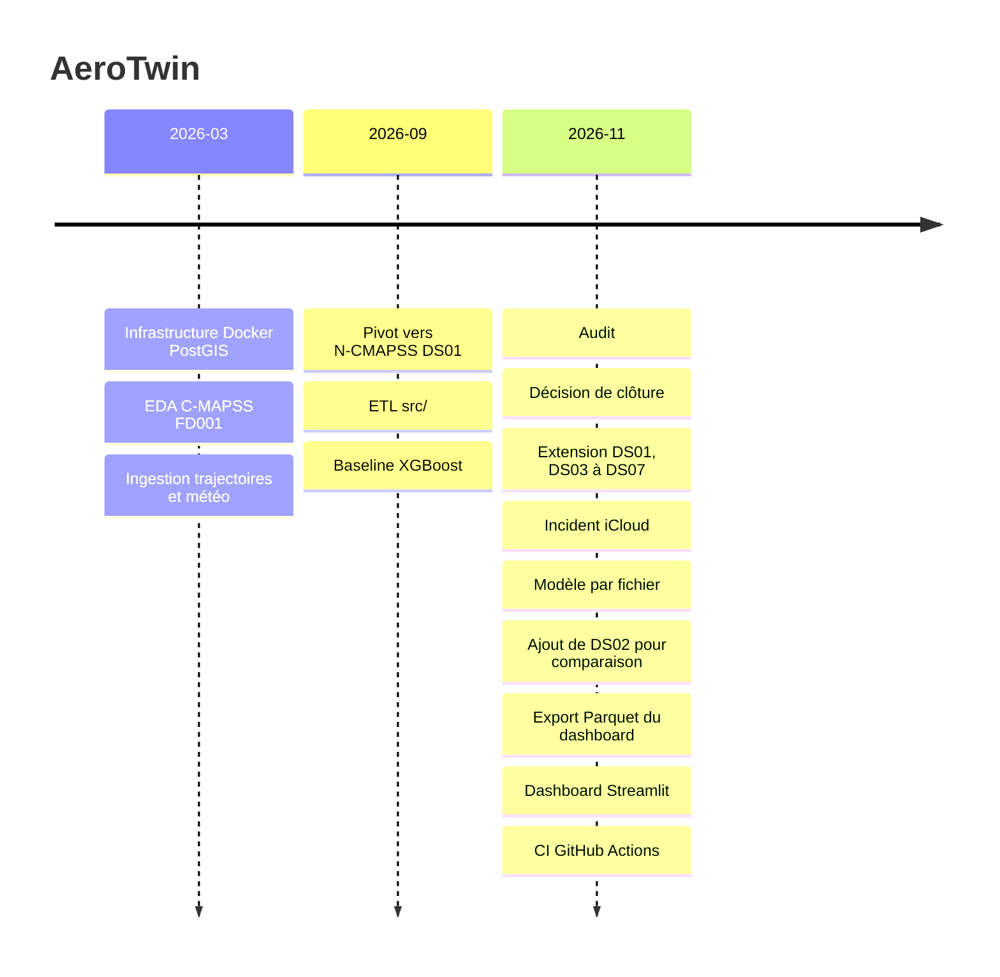

# Chronologie

| Date | Changement | Pourquoi | Référence |
|---|---|---|---|
| 2026-03-10 | Infrastructure Docker PostGIS + pgAdmin, premier notebook | Base de stockage géospatiale pour les trajectoires et la météo | `2528105`, [ADR-001](decisions/001-docker-postgis.md) |
| 2026-03-10 | README aligné sur le cahier des charges v1.0 | Cadrage initial | `f46aa3c`, `d08e3dc` |
| 2026-03-10 | Fin de la phase 0 : EDA sur C-MAPSS FD001, calcul de la RUL, corrélations | Première exploration du problème RUL | `a54d4a1` |
| 2026-03-16 | Début de la phase 1 : ingestion des trajectoires simulées et de la météo historique dans PostGIS | Contexte opérationnel des moteurs | `1c2ae54`, `0008829` |
| 2026-03-23 | Tests unitaires, fin de la phase 1 | Fiabiliser l'ingestion | `24c1f5b` |
| 2026-09-07 | Pivot vers N-CMAPSS DS01 : exploration, ETL dans `src/`, suppression des notebooks 01 à 04, nettoyage de FD001 | FD001 trop éloigné de conditions de vol réelles | `31f107f`, [ADR-002](decisions/002-abandon-fd001-ncmapss.md), [ADR-003](decisions/003-agregation-cycle.md), [ADR-004](decisions/004-exclusion-xv-t.md) |
| 2026-09-07 | Phase 4.1 : baseline XGBoost, RMSE test 11.79, CV 18.47 | Premier modèle RUL | `2ec1656`, [ADR-005](decisions/005-cv-leave-one-unit-out.md) |
| 2026-09 | Phase 4.2 : comparaison capped / uncapped, signature MLflow (commité le 2026-11-09) | Choisir entre RUL plafonnée ou non | `8019140` |
| 2026-11-06 | Audit du projet : plafond RUL sans effet, référence 36.89 non comparable, écart test / CV dû à la variance, commits non poussés, périmètre trop large | Revue avant publication | [ADR-006](decisions/006-cloture-projet.md) |
| 2026-11-09 | Décision de finir avec un dashboard puis de clôturer. Corrections : `.gitignore`, colonne `alt`, retrait de la référence 36.89 | Suites de l'audit | `9e791af`, [ADR-006](decisions/006-cloture-projet.md) |
| 2026-11-09 | Décision d'étendre à DS01 et DS03 à DS07 (six modes de panne, 65 moteurs), un modèle par fichier, DS08 exclu | Plus de moteurs et plusieurs modes de panne | [ADR-007](decisions/007-jeux-de-donnees.md) |
| 2026-11-09 | Téléchargement officiel N-CMAPSS, extraction de DS01 et DS03 à DS07, `read_ncmapss(ds_id)` | Données des six modes de panne, provenance tracée | [ADR-007](decisions/007-jeux-de-donnees.md), [data.md](data.md) |
| 2026-11-09 | Incident iCloud. Cause : projet dans `Documents`, synchronisé avec « Optimiser le stockage » ; avec 12 Go libres pendant l'extraction, macOS a retiré du disque environ 7 800 fichiers (surtout `venv/`, 24 objets `.git`, 2 ADR). Conséquence : `pyproj` ne pouvait plus lire `proj.db`, 2 tests en échec, et `34946b5` poussé malgré ces échecs car pytest était pipé dans `tail`, ce qui masquait son code de retour. Correction : projet déplacé hors d'iCloud, venv recréé, `git fsck` sans corruption, SHA-256 des six `.h5` conformes à `docs/data.md`, 17 tests verts. | Règle adoptée : vérifier le code de retour de pytest (0, sans pipe qui le masque) avant tout push | `34946b5` |
| 2026-11-09 | Décision d'ajouter DS02 uniquement pour la comparaison à la littérature, avec le découpage de la publication de référence (entraînement 2, 5, 10, 16, 18, 20 ; test 11, 14, 15). ADR-007 remplacée | Disposer d'un point de comparaison externe | [ADR-010](decisions/010-ajout-ds02.md) |
| 2026-11-09 | Étape 3 : un modèle XGBoost par fichier (`python -m src.train --all`), métriques par moteur et écart-type, suppression du plafond RUL, retrait des rolling features sur `RUL`, nettoyage des commentaires | Métriques honnêtes par moteur, un modèle par mode de panne | [ADR-008](decisions/008-plafond-rul.md), [resultats.md](resultats.md) |
| 2026-11-10 | Extraction de DS02 seul (marge de 10 Go autorisée pour cette extraction, SHA-256 consigné), unités conformes au découpage publié, modèle DS02 ajouté aux résultats, absent de la page Flotte | Comparaison à la littérature | [ADR-010](decisions/010-ajout-ds02.md), [data.md](data.md), [resultats.md](resultats.md) |
| 2026-11-10 | Dépendances directes figées dans `requirements.txt`, CI prévue en Python 3.13, résultats régénérés avec ces versions | Rendre les chiffres publiés reproductibles | [resultats.md](resultats.md) |
| 2026-11-10 | Archive `ncmapss_archive.zip` supprimée avec l'accord du propriétaire, les sept `.h5` extraits et contrôlés étant conservés | Libérer 15,8 Go | [data.md](data.md) |
| 2026-11-10 | Paragraphe « Situation par rapport à la littérature » dans `docs/resultats.md`, chiffres du préprint arXiv:2003.00732v2 cités comme préprint, hors du tableau de nos résultats | Situer la baseline sans comparaison trompeuse (RMSE par pas de temps contre RMSE par cycle) | [ADR-010](decisions/010-ajout-ds02.md), [ADR-006](decisions/006-cloture-projet.md), [resultats.md](resultats.md) |
| 2026-11-10 | Étape 4 : `python -m src.export_dashboard` écrit `data/dashboard/*.parquet` (prédictions par cycle, métriques, importances), prédictions hors échantillon pour les moteurs dev, DS02 marqué hors flotte | Le dashboard ne lit jamais le HDF5 | [resultats.md](resultats.md) |
| 2026-11-10 | Étape 5 : dashboard Streamlit à trois pages (`dashboard/app.py`, `dashboard/pages/`), page Flotte à un cycle observé plutôt qu'au dernier cycle, seuils 15 et 30 cycles, captures dans `docs/img/` | Au dernier cycle, la RUL réelle vaut 0 pour tous les moteurs : la flotte entière serait Critique | [ADR-009](decisions/009-streamlit-export-parquet.md) |
| 2026-11-10 | Statuts de la page Flotte calculés sur une RUL prudente (RUL prédite moins le RMSE test du fichier) ; instructions de déploiement dans le README | Une alerte manquée coûte plus qu'une fausse alerte, et l'erreur varie selon le mode de panne | [ADR-009](decisions/009-streamlit-export-parquet.md) |
| 2026-11-10 | Étape 6 : workflow `.github/workflows/tests.yml` en Python 3.13 à chaque push, `tests/test_phase3_etl.py` passé sur une fixture HDF5 | Les `.h5` ne sont pas dans le dépôt | `.github/workflows/tests.yml` |
