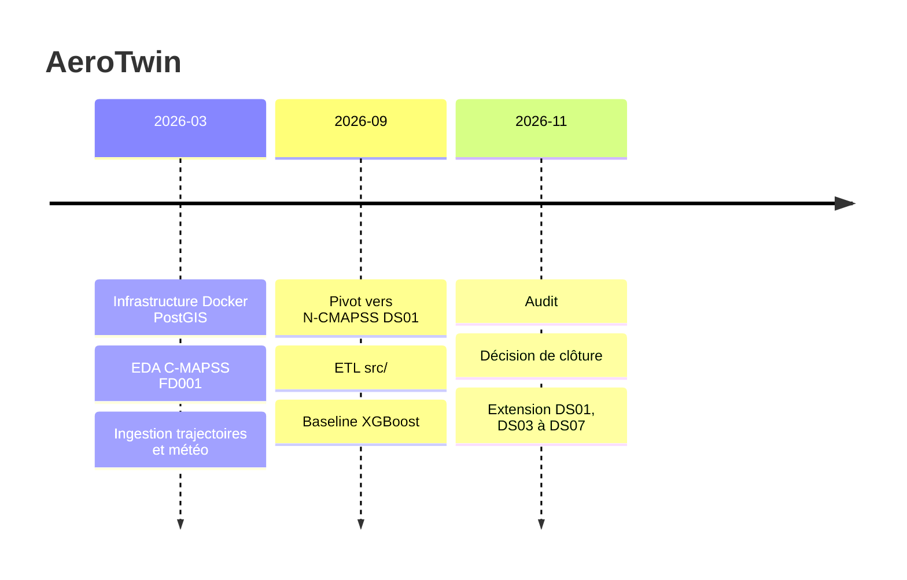

# Chronologie

| Date | Changement | Pourquoi | Référence |
|---|---|---|---|
| 2026-03-10 | Infrastructure Docker PostGIS + pgAdmin, premier notebook | Base de stockage géospatiale pour les trajectoires et la météo | `2528105`, [ADR-001](decisions/001-docker-postgis.md) |
| 2026-03-10 | README aligné sur le cahier des charges v1.0 | Cadrage initial | `f46aa3c`, `d08e3dc` |
| 2026-03-10 | Fin de la phase 0 : EDA sur C-MAPSS FD001, calcul de la RUL, corrélations | Première exploration du problème RUL | `a54d4a1` |
| 2026-03-16 | Début de la phase 1 : ingestion des trajectoires simulées et de la météo historique dans PostGIS | Contexte opérationnel des moteurs | `1c2ae54`, `0008829` |
| 2026-03-23 | Tests unitaires, fin de la phase 1 | Fiabiliser l'ingestion | `24c1f5b` |
| 2026-09-07 | Pivot vers N-CMAPSS DS01 : exploration, ETL dans `src/`, suppression des notebooks 01 à 04, nettoyage de FD001 | FD001 trop éloigné de conditions de vol réelles | `31f107f`, [ADR-002](decisions/002-abandon-fd001-ncmapss.md), [ADR-003](decisions/003-agregation-cycle.md), [ADR-004](decisions/004-exclusion-xv-t.md) |
| 2026-09-07 | Phase 4.1 : baseline XGBoost, RMSE test 11.79, CV 18.47 | Premier modèle RUL | `2ec1656`, [ADR-005](decisions/005-cv-leave-one-unit-out.md) |
| 2026-09 | Phase 4.2 : comparaison capped / uncapped, signature MLflow (commité le 2026-11-09) | Choisir entre RUL plafonnée ou non | `8019140` |
| 2026-11-06 | Audit du projet : plafond RUL sans effet, référence 36.89 non comparable, écart test / CV dû à la variance, commits non poussés, périmètre trop large | Revue avant publication | [ADR-006](decisions/006-cloture-projet.md) |
| 2026-11-09 | Décision de finir avec un dashboard puis de clôturer. Corrections : `.gitignore`, colonne `alt`, retrait de la référence 36.89 | Suites de l'audit | `9e791af`, [ADR-006](decisions/006-cloture-projet.md) |
| 2026-11-09 | Décision d'étendre à DS01 et DS03 à DS07 (six modes de panne, 65 moteurs), un modèle par fichier, DS08 exclu | Plus de moteurs et plusieurs modes de panne | [ADR-007](decisions/007-jeux-de-donnees.md) |
| 2026-11-09 | Téléchargement officiel N-CMAPSS, extraction de DS01 et DS03 à DS07, `read_ncmapss(ds_id)` | Données des six modes de panne, provenance tracée | [ADR-007](decisions/007-jeux-de-donnees.md), [data.md](data.md) |
